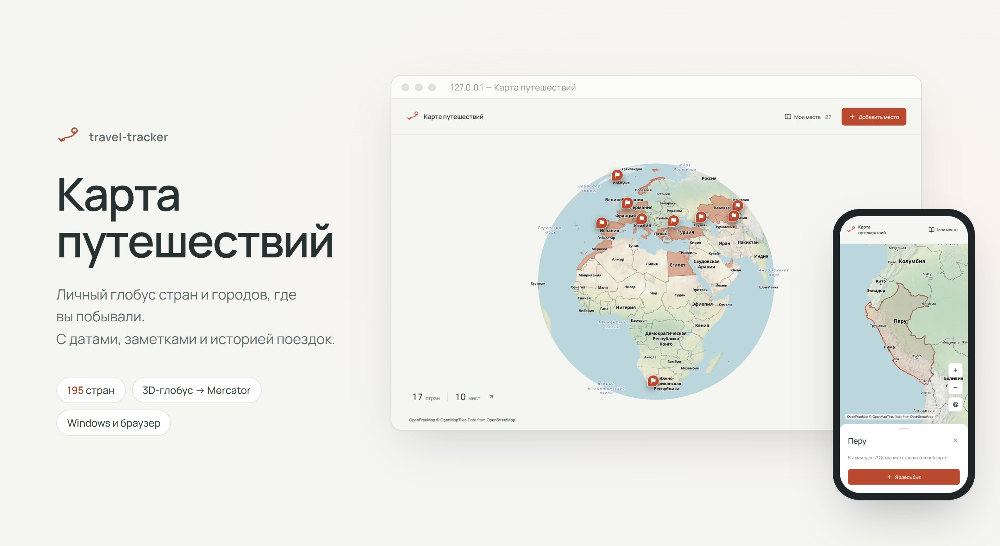
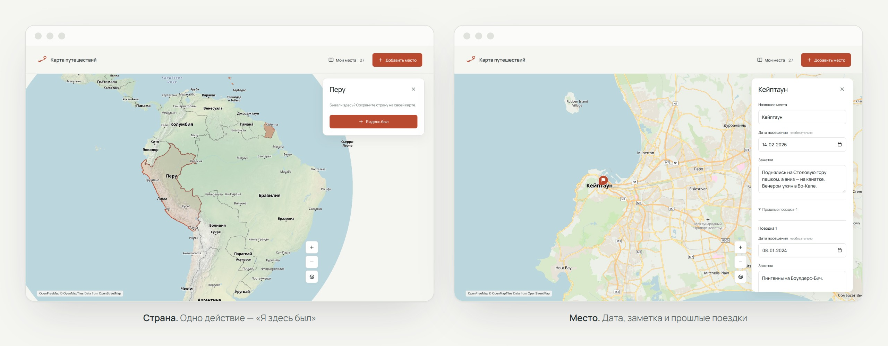
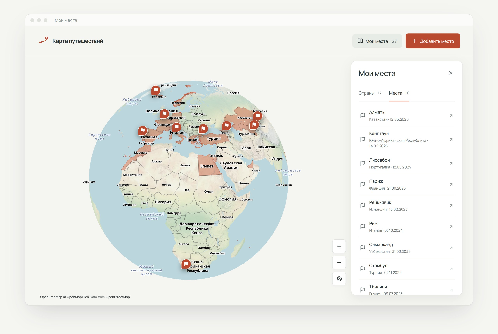
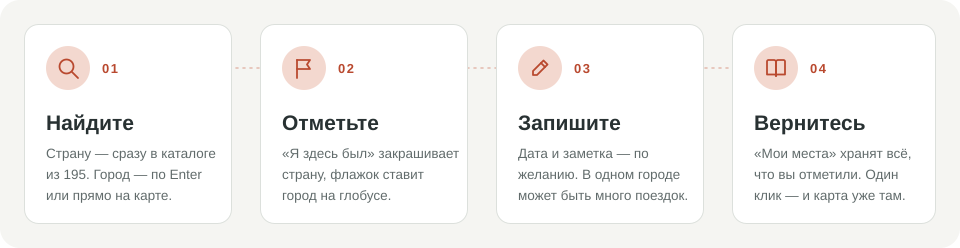
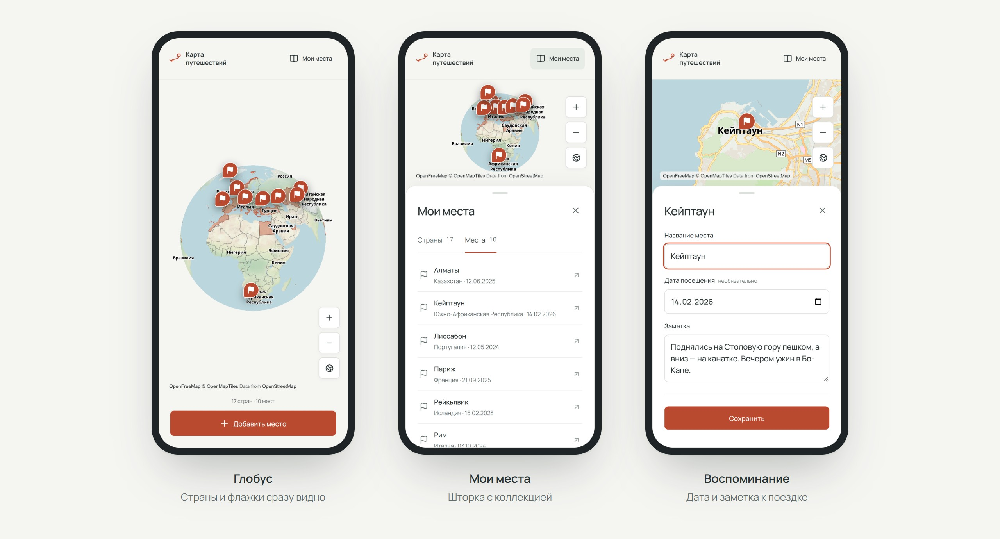
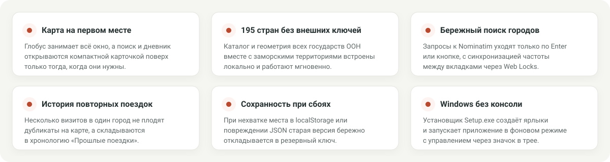
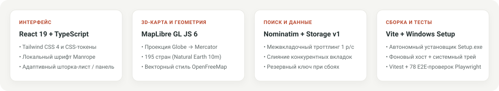

<div align="center">



<br />

**Личный атлас стран и городов, где вы побывали.**<br />
Интерактивный 3D-глобус, спокойный дневник поездок и бережное локальное хранение без облаков и регистрации.

<p>
  <a href="https://github.com/GL1NoMe5/travel-tracker/releases/latest/download/Setup.exe"></a>
  
  
  
  <a href="docs/verification.md"></a>
</p>

<p>
  <a href="#установка-для-windows">Скачать для Windows</a> ·
  <a href="#интерфейс">Интерфейс</a> ·
  <a href="#как-это-работает">Как это работает</a> ·
  <a href="#на-телефоне-и-компьютере">Мобильная версия</a> ·
  <a href="#принципы-и-сохранность-данных">Сохранность данных</a> ·
  <a href="#под-капотом">Под капотом</a> ·
  <a href="#запуск-из-исходников">Запуск из исходников</a>
</p>

</div>

---

**Карта путешествий** убирает всё лишнее между вами и географией ваших поездок. Большую часть экрана занимает живой глобус, который при приближении плавно переходит в детальную плоскую карту, а управление сведено к двум главным действиям — **«Добавить место»** и **«Мои места»**.

Отмечайте посещённые страны одним нажатием, находите города через встроенный поиск или ставьте точки прямо на карте, сохраняйте даты, короткие воспоминания и возвращайтесь к хронологии прошлых визитов. Приложение работает без платных API-ключей, аккаунтов и внешних баз данных: вся коллекция живёт локально на вашем устройстве.

---

## Установка для Windows

Для обычного использования на компьютере не нужны ни терминал, ни установленный Node.js:

1. **[Скачайте Setup.exe](https://github.com/GL1NoMe5/travel-tracker/releases/latest/download/Setup.exe)** из последнего релиза.
2. При желании выберите папку установки кнопкой **«Обзор»** и нажмите **«Установить»**.
3. Ярлыки **«Карта путешествий»** появятся в меню «Пуск» и на рабочем столе, а карта сразу откроется в вашем браузере по умолчанию.

Приложение работает через тихий локальный хост в фоновом режиме. Чтобы полностью закрыть его, нажмите правой кнопкой мыши на значок в области уведомлений Windows (системном трее) и выберите **«Выйти»**.

> [!NOTE]
> Установщик пока не подписан платным сертификатом издателя, поэтому при первом запуске Windows SmartScreen может показать предупреждение — нажмите **«Подробнее» → «Выполнить в любом случае»**. Подробное руководство по установке, обновлению и удалению собрано в **[инструкции для Windows](docs/windows-setup.md)**.

---

## Интерфейс

Дизайн построен вокруг спокойной бумажной палитры (`#F5F5F2`), глубокого графитового текста (`#283132`), тёплого терракотового акцента (`#B9492F`) и локального шрифта **Manrope**. Карточки не перекрывают весь мир: они появляются справа на компьютере или компактной шторкой снизу на телефоне только тогда, когда вы выбираете страну или редактируете запись.

<p align="center">
  
</p>
<p align="center">
  <sub>Слева — быстрая отметка страны прямо на глобусе. Справа — карточка города с датой, личной заметкой и раскрывающимся списком «Прошлые поездки».</sub>
</p>

<br />

Когда коллекция растёт, панель **«Мои места»** и компактная сводка в левом нижнем углу позволяют быстро переключаться между списком стран и конкретными городами, мгновенно перелетая к нужной точке на карте.

<p align="center">
  
</p>
<p align="center">
  <sub>Раздел «Мои места» разделяет отмеченные страны и сохранённые города с датами визитов. Выбор любой строки плавно переносит камеру к месту.</sub>
</p>

---

## Как это работает

<p align="center">
  
</p>

1. **Отмечайте страны на глобусе.** Нажмите на любую из 195 стран прямо на карте и выберите **«Я здесь был»** — контур окрасится в терракотовый цвет, а страна добавится в вашу коллекцию. Кнопка **«Убрать отметку»** в любой момент отменяет посещение.
2. **Ищите страны и города в одном поле.** Откройте **«Добавить место»** и начните вводить название. Страны находятся мгновенно по встроенному каталогу; чтобы найти город или посёлок через OpenStreetMap Nominatim, нажмите `Enter` или значок поиска.
3. **Ставьте точки вручную.** Если нужно отметить место вдали от крупных городов, выберите **«Добавить место» → «Выбрать на карте»** и кликните в нужную точку. Если автоматическое обратное геокодирование не определит название, его всегда можно вписать вручную.
4. **Записывайте детали и историю поездок.** Укажите дату поездки и короткую заметку, затем нажмите **«Сохранить»**. При повторном визите в тот же город приложение предложит добавить новую поездку к уже существующей точке или создать отдельную запись (**«Это другое место»**) — одноимённые города в разных странах или регионах никогда не склеиваются без вашего согласия.
5. **Возвращайтесь к воспоминаниям.** В разделе **«Мои места»** собраны все страны и точки, а внутри карточки каждого города в блоке **«Прошлые поездки»** бережно хранится полная история прежних визитов. Добавление города само по себе не закрашивает страну автоматически — вы сами решаете, какие страны считать посещёнными.

---

## На телефоне и компьютере

Адаптивная вёрстка подстраивается под размер экрана: на широких мониторах инструменты открываются плавающей боковой карточкой справа, а на узких экранах и смартфонах — удобным нижним листом (bottom sheet), оставляя глобус открытым для вращения и масштабирования.

<p align="center">
  
</p>
<p align="center">
  <sub>Адаптивный интерфейс на мобильном экране: чистый 3D-глобус, быстрый доступ к списку мест и карточка воспоминания в нижней части экрана.</sub>
</p>

---

## Принципы и сохранность данных

<p align="center">
  
</p>

Приложение спроектировано так, чтобы ваши записи оставались в безопасности даже при сбоях браузера, нехватке квоты хранилища или одновременной работе в нескольких вкладках.

<details>
<summary><strong>Хранение в браузере, резервные копии при сбоях и работа с сетью</strong></summary>
<br />

- **Локальная привязка к профилю браузера.** Все подтверждённые изменения автоматически сохраняются в `localStorage` текущего браузера по адресу `http://127.0.0.1:5173` (ключ `travel-tracker:data:v1`). Другой браузер, гостевой профиль или иной порт откроют отдельную коллекцию, а полная очистка данных сайта в настройках браузера удалит поездки. Ранее сохранённые страны, индивидуальные цвета из прошлых версий, места, даты и заметки полностью совместимы с текущим интерфейсом.
- **Защита от переполнения и ошибок записи.** Если браузер не смог записать изменения на диск, они остаются в оперативной памяти открытой вкладки. Воспользуйтесь кнопкой **«Повторить сохранение»** и дождитесь исчезновения предупреждения перед закрытием окна.
- **Синхронизация и слияние между вкладками.** Если вы изменили коллекцию в соседней вкладке, приложение обнаружит расхождение версий при сохранении или по событию `storage` и аккуратно объединит записи либо предложит загрузить актуальное состояние.
- **Бережное восстановление при повреждении JSON.** Если данные в хранилище оказались повреждены сторонним вмешательством, запись поверх них блокируется, чтобы ничего не затереть. Только в этом состоянии появляется действие **«Начать заново»**: перед очисткой приложение сначала сохраняет точную резервную копию исходной строки в отдельный ключ браузера и лишь после успешного бэкапа создаёт чистую карту.
- **Интернет и поиск (Nominatim + Web Locks).** Подложка карты OpenFreeMap и поиск городов требуют подключения к интернету. Чтобы соблюдать правила использования OpenStreetMap Nominatim (не более 1 запроса в секунду и никаких запросов на каждый символ при вводе), геокодер использует браузерный механизм `Web Locks` в защищённом контексте (`localhost` / `127.0.0.1` или `HTTPS`). Если `Web Locks` недоступен, вы по-прежнему можете выбирать точки прямо на карте и называть их вручную. Конфигурация провайдера задаётся в [`public/config.json`](public/config.json) и подробно описана в **[документации по геокодированию](docs/geocoding.md)**.

</details>

---

## Под капотом

<p align="center">
  
</p>

Проект разделён на независимые слои с чёткими контрактами: картографический движок [`TravelMap`](src/map/TravelMap.tsx) отвечает только за WebGL-рендеринг глобуса, границ и маркеров, [`persistence`](src/storage/persistence.ts) гарантирует целостность схемы `v1`, а [`geocoder`](src/services/geocoder/index.ts) изолирует сетевой поиск и межвкладочную очередь запросов.

<details>
<summary><strong>Геометрия 195 стран и документация разработчика</strong></summary>
<br />

- **Каталог 195 государств ООН.** Геометрия стран подготовлена из публичных данных Natural Earth (`10m Admin 0`) и вынесена в отдельный статический файл [`public/data/countries.geojson`](public/data/countries.geojson), чтобы не утяжелять основной JavaScript-бандл. Франция, Нидерланды, Дания и другие государства сохраняют заморские территории как часть единого `MultiPolygon`, а карликовые государства (Ватикан, Монако, Сан-Марино, Лихтенштейн, Науру, Тувалу и др.) снабжены точной полигональной геометрией. Для пересборки датасета используется скрипт [`scripts/prepare-countries.mjs`](scripts/prepare-countries.mjs).
- **Документация по модулям:**
  - **[Архитектура](docs/architecture.md)** — границы модулей, модель данных, обработка ошибок и конкурентных изменений.
  - **[Дизайн-система](DESIGN.md)** — типографика Manrope (поставляется локально с OFL-лицензией в [`public/fonts/`](public/fonts/)), цветовые токены и композиционные правила.
  - **[Редизайн интерфейса и источники](docs/ui-redesign.md)** — как применялись принципы [Unslop](https://github.com/heydamir/unslop) и [Impeccable](https://github.com/pbakaus/impeccable), версии и лицензии.
  - **[Источники геоданных](docs/data-sources.md)** — правила сборки 195 стран, исключённые спорные территории и контрольные суммы SHA-256.
  - **[Геокодирование](docs/geocoding.md)** — настройка провайдера в `public/config.json`, таймауты и межвкладочное ограничение частоты.
  - **[Отчёт приёмки и верификации](docs/verification.md)** — фактические результаты всех автоматических и визуальных проверок.

</details>

---

## Запуск из исходников

Для локальной разработки и сборки из исходного кода потребуется **Node.js 22.12** или новее:

```powershell
git clone https://github.com/GL1NoMe5/travel-tracker.git
cd travel-tracker
npm ci
npm run dev
```

Откройте адрес из вывода Vite — обычно `http://127.0.0.1:5173`. Локальный кэш пакетов npm настроен внутри папки `.cache/npm` проекта. Начальное состояние приложения всегда чистое и не содержит демонстрационных поездок.

### Проверки, тесты и сборка установщика

```powershell
npm run typecheck    # Проверка типов TypeScript
npm test             # Модульные тесты Vitest (доменная логика, хранилище, геокодер, карта)
npm run build        # Production-сборка в dist/
npm run test:e2e     # 78 сквозных сценариев Playwright (1440×900 и 390×844 в Google Chrome)
npm run preview      # Локальный предпросмотр production-сборки (обычно http://127.0.0.1:4173)
```

Чтобы собрать автономный установщик Windows (`release/Setup.exe` и `release/Setup.exe.sha256`), выполните на Windows с PowerShell и .NET Framework:

```powershell
npm run build:setup
```

Для отдельной визуальной проверки с настоящей живой подложкой **OpenFreeMap** (при запущенном `npm run preview`):

```powershell
node scripts/verify-live-map.mjs
```

Скрипт проверяет живую загрузку тайлов и шрифтов карты, перехватывая только поисковые запросы к Nominatim локальной фикстурой, и сохраняет отчёт со скриншотами в `artifacts/ui-redesign/` (адрес и папку можно переопределить через переменные `TRAVEL_E2E_BASE_URL` и `TRAVEL_QA_OUTPUT`). При каждом push и pull request все проверки и сборка `Setup.exe` также автоматически прогоняются в GitHub Actions.

---

<div align="center">
  <sub>Создано для бережного хранения личной географии путешествий · <a href="https://github.com/GL1NoMe5/travel-tracker/releases/latest/download/Setup.exe">Скачать Setup.exe</a> · <a href="docs/windows-setup.md">Инструкция для Windows</a> · <a href="docs/verification.md">Отчёт проверок</a></sub>
</div>
